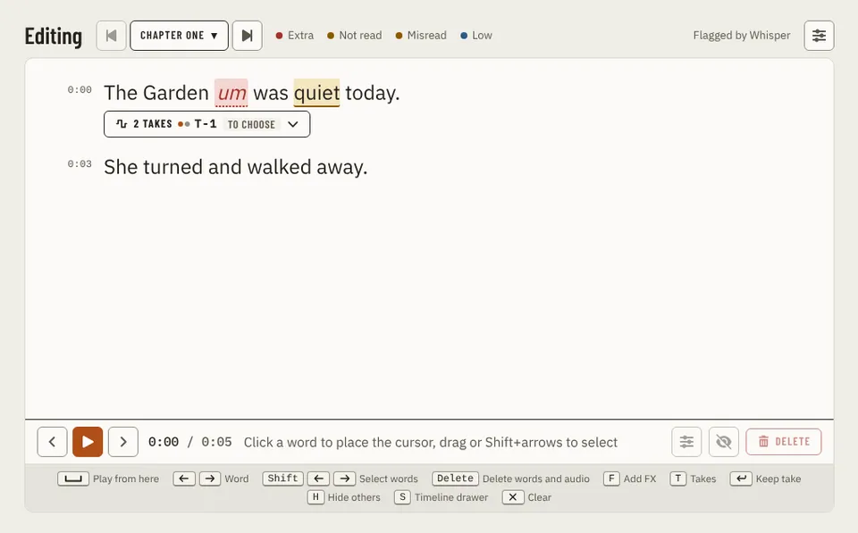

# Page-page

Storybook title: `Editing/Page`. Source: `src/components/editing/EditingPage.stories.tsx`.

## Stories

- Default
- Selection
- Takes Open
- Drawer Clean Up
- Drawer Effects
- Drawer Backups
- Daw Off
- Built In
- Not Transcribed
- No Text
- No Manuscript

## Used by

- nothing outside its own stories and tests yet
