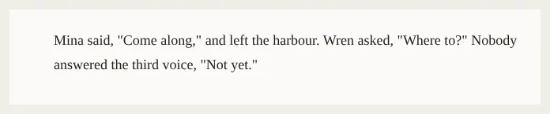

# Para

Storybook title: `Script/Reader/Para`. Source: `src/components/script/page/reader/Para.tsx`.

## Stories

- Plain Text
- Marks Of Each Style
- Overlapping Marks
- Flagged Words
- Name Mentions
- Speaker Chips
- Find Matches
- All Layers

## Used by

- `src/components/script/page/reader/Reader.tsx`
