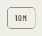

# Pill

Storybook title: `Primitives/Pill`. Source: `src/components/primitives/Pill.tsx`.

## Stories

- Inactive
- Active
- Disabled
- Disabled With Reason
- With Tooltip
- Click Selects
- Announces Its Pressed State
- Filter Inactive
- Filter Active
- Action Raised With Icon

## Used by

- `src/components/master/MasteringApprovalDialog.tsx`
- `src/components/primitives/ToggleGroup.tsx`
- `src/components/proof/checkcard/CheckCard.tsx`
- `src/components/proof/notes/NotesPanel.tsx`
