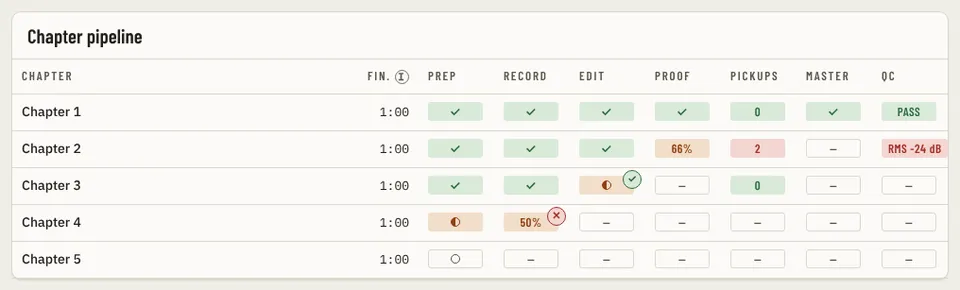

# PipelineTable

Storybook title: `Production/PipelineTable`. Source: `src/components/production/pipeline/PipelineTable.tsx`.

## Stories

- Mid Book
- Finished
- Nothing Recorded
- Long Chapter Name

## Used by

- `src/components/production/ProductionPage.tsx`
