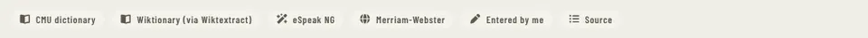

# PronSourceTag

Storybook title: `StoryBible/PronSourceTag`. Source: `src/components/storybible/source/PronSourceTag.tsx`.

## Stories

- Each Source Read Only
- Button
- Menu With Unavailable Sources
- Name Row Editing
- Name Row Read Only

## Used by

- `src/components/script/page/rail/bible/EntryCard.tsx`
- `src/components/script/page/rail/words/WordCard.tsx`
- `src/components/storybible/source/NamePronunciation.tsx`
