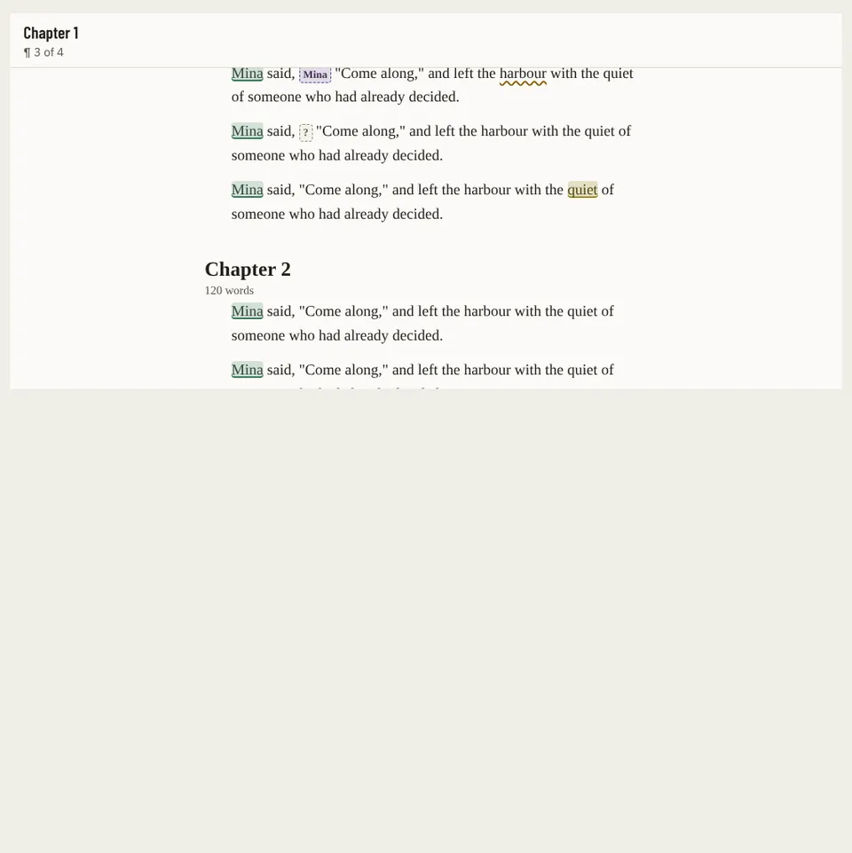

# Reader

Storybook title: `Script/Reader`. Source: `src/components/script/page/reader/Reader.tsx`.

## Stories

- Marks Chips And A Find Match
- Without Layers

## Used by

- `src/components/script/page/ScriptPage.tsx`
