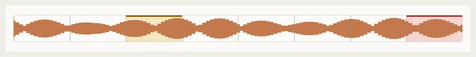

# Ribbon

Storybook title: `Editing/Ribbon`. Source: `src/components/editing/ribbon/Ribbon.tsx`.

## Stories

- Default
- Selection
- Playing
- Flagged
- No Audio

## Used by

- `src/components/editing/page/EditingBody.tsx`
- `src/components/editing/strip/TimelineStrip.tsx`
