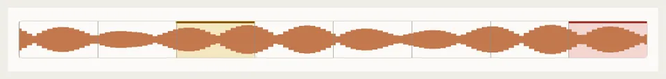

# Ribbon

Storybook title: `Editing/Ribbon`. Source: `src/components/editing/ribbon/Ribbon.tsx`.

## Stories

- Default
- Selection
- Playing
- Playing At Several Positions
- Flagged And Cut While Playing
- Flagged
- Swell While Playing
- Reading The Waveform
- No Audio

## Used by

- `src/components/editing/ribbon/WaveDock.tsx`
