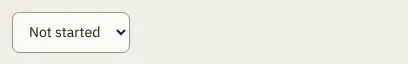

# Select

Storybook title: `Primitives/Select`. Source: `src/components/primitives/Select.tsx`.

## Stories

- Default
- Full Width
- Disabled
- With Placeholder Option
- Choosing Reports The Value
- Keyboard Reaches It

## Used by

- `src/components/booth/frame/LevelsMenu.tsx`
- `src/components/delivery/ImportProfileField.tsx`
- `src/components/delivery/profile/ProfileMenu.tsx`
- `src/components/editing/menu/marks/NoteDialog.tsx`
- `src/components/editing/range/cut/CutDialog.tsx`
- `src/components/editing/range/fx/FxDialog.tsx`
- `src/components/engine/ChapterSyncPanel.tsx`
- `src/components/engine/CreateChapterRegionsDialog.tsx`
- `src/components/engine/LinkChaptersDialog.tsx`
- `src/components/mapping/MappingConfirm.tsx`
- `src/components/master/MasterToSpecPanel.tsx`
- `src/components/production/CreditsRowPanel.tsx`
- `src/components/production/ImportReview.tsx`
- `src/components/proof/AuditionDialog.tsx`
- `src/components/proof/NativeTakesPanel.tsx`
- `src/components/proof/inspector/TypeSelect.tsx`
- `src/components/proof/notes/NotesPanel.tsx`
- `src/components/recordingcheck/CheckRecordingsDialog.tsx`
- `src/components/schedule/ContractPanel.tsx`
- `src/components/schedule/MilestoneDialog.tsx`
- `src/components/script/page/rail/threads/NoteCard.tsx`
- `src/components/script/page/tools/select/MarkComposer.tsx`
- `src/components/script/page/tools/select/MarksDialog.tsx`
- `src/components/script/page/tools/text/TextSettings.tsx`
- `src/components/settings/CreditsPanel.tsx`
- `src/components/settings/DeliveryProfilesPanel.tsx`
- `src/components/settings/RetailSamplePanel.tsx`
- `src/components/settings/ScopedSetting.tsx`
- `src/components/settings/page/DeliveryProfileField.tsx`
- `src/components/settings/page/StoryBibleTypesPanel.tsx`
- `src/components/storybible/DialogueCueAttribution.tsx`
- `src/components/storybible/Guide.tsx`
- `src/components/storybible/SpeakerColourField.tsx`
- `src/components/storybible/VoiceReferencesSection.tsx`
