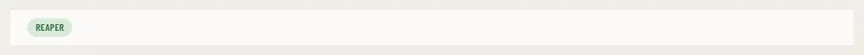

# SetupChip

Storybook title: `Booth/SetupChip`. Source: `src/components/booth/record/SetupChip.tsx`.

## Stories

- Connected
- Not Linked
- Linked Not Started
- Not Running
- Records In The App

## Used by

- `src/components/booth/page/BoothNextPage.tsx`
