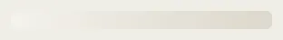

# Skeleton

Storybook title: `Primitives/Skeleton`. Source: `src/components/primitives/Skeleton.tsx`.

## Stories

- Line
- Tall
- Region

## Used by

- `src/components/booth/companion/CompanionSkeleton.tsx`
- `src/components/booth/page/BoothSkeleton.tsx`
- `src/components/delivery/page/Preflight.tsx`
- `src/components/editing/EditingPage.tsx`
- `src/components/editing/page/EditingSkeleton.tsx`
- `src/components/masterqc/page/PackageChecks.tsx`
- `src/components/pickups/list/PickupsTable.tsx`
- `src/components/pickups/list/SessionPanel.tsx`
- `src/components/production/overview/ProductionSkeleton.tsx`
- `src/components/proof/ProofChapterPage.tsx`
- `src/components/proof/frame/ProofSkeleton.tsx`
- `src/components/schedule/ScheduleSkeleton.tsx`
- `src/components/script/page/layout/ScriptSkeleton.tsx`
- `src/components/series/SeriesSkeleton.tsx`
- `src/components/settings/page/ModelsPane.tsx`
- `src/components/settings/page/SettingsPage.tsx`
- `src/components/storybible/GuideSkeleton.tsx`
