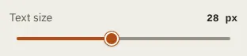

# Slider

Storybook title: `Primitives/Slider`. Source: `src/components/primitives/Slider.tsx`.

## Stories

- With Label And Readout
- Without Header
- At Minimum
- At Maximum
- Disabled
- Track Meets Its Label

## Used by

- `src/components/booth/frame/BoothTop.tsx`
- `src/components/booth/frame/LevelsMenu.tsx`
- `src/components/editing/effects/EffectSettings.tsx`
- `src/components/editing/output/OutputControls.tsx`
- `src/components/recordingcheck/RunOptions.tsx`
- `src/components/script/page/tools/text/TextSettings.tsx`
- `src/components/settings/controls/AppearanceBodies.tsx`
