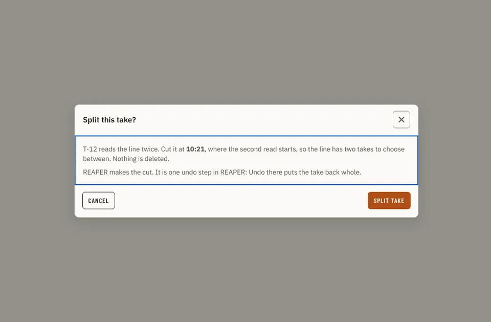

# Split

Storybook title: `Editing/Split`. Source: `src/components/editing/takes/split/Split.stories.tsx`.

## Stories

- Confirm Daw
- Confirm With Backup
- Confirm Recorder
- Card With Split
- Button Ready
- Button Refused

## Used by

- nothing outside its own stories and tests yet
