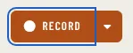

# SplitButton

Storybook title: `Primitives/SplitButton`. Source: `src/components/primitives/SplitButton.tsx`.

## Stories

- Default
- Cold Read
- Stopping
- Pending

## Used by

- `src/components/booth/frame/BoothFooter.tsx`
- `src/components/booth/frame/LevelsMenu.tsx`
- `src/components/booth/record/RecordControl.tsx`
- `src/components/editing/takes/split/useSplitDuplicate.tsx`
