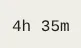

# SpokenFigure

Storybook title: `Primitives/SpokenFigure`. Source: `src/components/primitives/SpokenFigure.tsx`.

## Stories

- Default
- Inside Text
- Under A Minute
- Plain Text

## Used by

- `src/components/primitives/StatTile.tsx`
- `src/components/production/overview/StageBar.tsx`
- `src/components/production/pipeline/PipelineTable.tsx`
- `src/components/schedule/WorkedOut.tsx`
