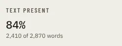

# StatTile

Storybook title: `Primitives/StatTile`. Source: `src/components/primitives/StatTile.tsx`.

## Stories

- Default
- No Hint
- With Unit
- With Progress
- Progress is thin and ok-toned
- Success
- Warning
- Danger
- Info
- Long Label Wraps
- With Icon
- Compact

## Used by

- `src/components/primitives/ActivityPanel.tsx`
- `src/components/primitives/StatStrip.tsx`
- `src/components/production/RecordingCheckReport.tsx`
- `src/components/production/overview/KpiRow.tsx`
