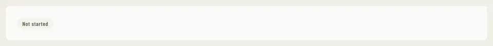

# StatusBadge

Storybook title: `Primitives/StatusBadge`. Source: `src/components/primitives/StatusBadge.tsx`.

## Stories

- Neutral
- Info
- Progress
- Success
- Warning
- Danger
- Accent
- Org
- Every Shape And Look
- Measured Shapes
- Outline
- Opens What It Counts
- With Icon
- Dot
- All Tones As Dots
- Announces Its Label

## Used by

- `src/chapterStatus.ts`
- `src/components/booth/CompanionShell.tsx`
- `src/components/booth/CompanionThisChapter.tsx`
- `src/components/booth/frame/BoothTop.tsx`
- `src/components/booth/frame/LevelsMenu.tsx`
- `src/components/booth/pickups/PickupSession.tsx`
- `src/components/booth/reading/SpeakerChip.tsx`
- `src/components/booth/side/VoicesInChapter.tsx`
- `src/components/booth/suspected/SuspectedLines.tsx`
- `src/components/booth/voices/VoiceControl.tsx`
- `src/components/booth/voices/WhoIsInDialog.tsx`
- `src/components/credits/CreditsSetupBanner.tsx`
- `src/components/delivery/page/OutputPanel.tsx`
- `src/components/delivery/page/Preflight.tsx`
- `src/components/delivery/profile/ProfileCard.tsx`
- `src/components/editing/EditingCheckPanel.tsx`
- `src/components/editing/backups/BackupsList.tsx`
- `src/components/editing/bar/SelectionBar.tsx`
- `src/components/editing/cleanup/CleanupList.tsx`
- `src/components/editing/effects/CoverageStrip.tsx`
- `src/components/editing/flags/Legend.tsx`
- `src/components/editing/script/ScriptDoc.tsx`
- `src/components/editing/stack/RetryBar.tsx`
- `src/components/editing/strip/TimelineStrip.tsx`
- `src/components/editing/takes/Suggested.tsx`
- `src/components/editing/takes/TakeChip.tsx`
- `src/components/editing/takes/TakeLines.tsx`
- `src/components/editing/takes/prep/PrepControls.tsx`
- `src/components/editing/voicesample/SampleMark.tsx`
- `src/components/engine/AudacityLinkCard.tsx`
- `src/components/engine/ChapterLinksTable.tsx`
- `src/components/engine/ChapterSyncPanel.tsx`
- `src/components/engine/ChapterTagsDialog.tsx`
- `src/components/engine/LinkChaptersDialog.tsx`
- `src/components/engine/RetakeLanesDialog.tsx`
- `src/components/engine/ToolResult.tsx`
- `src/components/engine/TrackList.tsx`
- `src/components/engine/audacityLinkText.ts`
- `src/components/layout/EngineChip.tsx`
- `src/components/layout/HistoryPanel.tsx`
- `src/components/master/DiagnosticsTables.tsx`
- `src/components/master/MasterToSpecPanel.tsx`
- `src/components/master/MasteringApprovalDialog.tsx`
- `src/components/master/MasteringChain.tsx`
- `src/components/master/RuleBadges.tsx`
- `src/components/masterqc/files/FileChecks.tsx`
- `src/components/masterqc/files/FilesTable.tsx`
- `src/components/masterqc/page/PackageChecks.tsx`
- `src/components/pickups/list/PickupsTable.tsx`
- `src/components/primitives/ActivityPanel.tsx`
- `src/components/primitives/HeaderChip.tsx`
- `src/components/primitives/KindChip.tsx`
- `src/components/primitives/SpeakerTag.tsx`
- `src/components/primitives/StageGrid.tsx`
- `src/components/production/ImportReview.tsx`
- `src/components/production/overview/StageBar.tsx`
- `src/components/production/pipeline/NextUp.tsx`
- `src/components/production/pipeline/PageHeader.tsx`
- `src/components/production/pipeline/PipelineTable.tsx`
- `src/components/production/readiness/ReadinessChip.tsx`
- `src/components/production/readiness/ReadinessPanel.tsx`
- `src/components/production/readiness/verdict.ts`
- `src/components/proof/checkcard/CheckCard.tsx`
- `src/components/proof/checkcard/FindingRow.tsx`
- `src/components/proof/notes/NotesTable.tsx`
- `src/components/proof/notes/noteRows.ts`
- `src/components/proof/spot/SpotTakes.tsx`
- `src/components/proof/spot/TakesBadge.tsx`
- `src/components/schedule/MilestoneTable.tsx`
- `src/components/schedule/VerdictPill.tsx`
- `src/components/script/page/rail/bible/EntryCard.tsx`
- `src/components/script/page/rail/threads/NoteCard.tsx`
- `src/components/script/page/rail/words/WordCard.tsx`
- `src/components/script/page/rail/words/wordStatus.ts`
- `src/components/settings/CapabilitySection.tsx`
- `src/components/settings/KeyboardPanel.tsx`
- `src/components/settings/analysis/ToolRow.tsx`
- `src/components/settings/controls/CapabilitiesBody.tsx`
- `src/components/settings/controls/CreditsBody.tsx`
- `src/components/settings/controls/DefinitionsBody.tsx`
- `src/components/settings/controls/EngineBody.tsx`
- `src/components/settings/controls/MwKeyBody.tsx`
- `src/components/settings/installPill.ts`
- `src/components/settings/models/AssetRow.tsx`
- `src/components/settings/page/CategoryNav.tsx`
- `src/components/settings/page/MarksPanel.tsx`
- `src/components/settings/row/AssetNote.tsx`
- `src/components/settings/row/SettingRowView.tsx`
- `src/components/stages/StageSuggestion.tsx`
- `src/components/storybible/FilterMenu.tsx`
- `src/components/storybible/GuideDetail.tsx`
- `src/components/storybible/Relationships.tsx`
- `src/components/storybible/VoiceReferencesSection.tsx`
- `src/components/storybible/source/PronSourceTag.tsx`
- `src/components/storybible/source/PronunciationCandidates.tsx`
- `src/components/storybible/suggested/import/ImportDialog.tsx`
- `src/components/storybible/suggested/panel/EntryVerifyPill.tsx`
- `src/components/storybible/suggested/panel/LooseSuggestionRows.tsx`
- `src/components/storybible/suggested/panel/ScanStatus.tsx`
- `src/components/storybible/suggested/row/ConfidenceChip.tsx`
- `src/components/storybible/suggested/row/SuggestionRow.tsx`
- `src/components/storybible/voicesamples/VoiceSampleRow.tsx`
- `src/components/storybible/voicesamples/VoiceSamplesBody.tsx`
- `src/kinds/kindMap.ts`
- `src/kinds/statusTone.ts`
