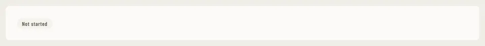

# StatusBadge

Storybook title: `Primitives/StatusBadge`. Source: `src/components/primitives/StatusBadge.tsx`.

## Stories

- Neutral
- Info
- Progress
- Success
- Warning
- Danger
- Experimental
- Accent
- Org
- Every Shape And Look
- Measured Shapes
- Outline
- Opens What It Counts
- With Icon
- Dot
- All Tones As Dots
- Announces Its Label

## Used by

- `src/chapterStatus.ts`
- `src/components/booth/BoothView.tsx`
- `src/components/booth/BuiltinRecorder.tsx`
- `src/components/booth/CompanionShell.tsx`
- `src/components/booth/CompanionThisChapter.tsx`
- `src/components/booth/ReaderRail.tsx`
- `src/components/booth/frame/BoothTop.tsx`
- `src/components/credits/CreditsSetupBanner.tsx`
- `src/components/delivery/page/OutputPanel.tsx`
- `src/components/delivery/page/Preflight.tsx`
- `src/components/delivery/profile/ProfileCard.tsx`
- `src/components/editing/bar/SelectionBar.tsx`
- `src/components/editing/flags/FlagCard.tsx`
- `src/components/editing/flags/Legend.tsx`
- `src/components/editing/script/ScriptDoc.tsx`
- `src/components/editing/strip/TimelineStrip.tsx`
- `src/components/editing/takes/Suggested.tsx`
- `src/components/editing/takes/TakeChip.tsx`
- `src/components/editing/takes/TakeLines.tsx`
- `src/components/editing/takes/prep/PrepControls.tsx`
- `src/components/engine/EnginePanel.tsx`
- `src/components/layout/HistoryPanel.tsx`
- `src/components/manuscript/ChapterNav.tsx`
- `src/components/manuscript/EntitySummary.tsx`
- `src/components/manuscript/ReaderCard.tsx`
- `src/components/master/MasteringChain.tsx`
- `src/components/master/RuleBadges.tsx`
- `src/components/masterqc/files/FileChecks.tsx`
- `src/components/masterqc/files/FilesTable.tsx`
- `src/components/masterqc/page/PackageChecks.tsx`
- `src/components/primitives/CapabilityGate.tsx`
- `src/components/primitives/HeaderChip.tsx`
- `src/components/primitives/SpeakerTag.tsx`
- `src/components/primitives/StageGrid.tsx`
- `src/components/production/pipeline/PipelineTable.tsx`
- `src/components/production/readiness/ReadinessChip.tsx`
- `src/components/production/readiness/ReadinessPanel.tsx`
- `src/components/production/readiness/verdict.ts`
- `src/components/proof/FlagsPanel.tsx`
- `src/components/proof/ScriptView.tsx`
- `src/components/proof/TakesPanel.tsx`
- `src/components/proof/checkcard/CheckCard.tsx`
- `src/components/proof/checkcard/FindingRow.tsx`
- `src/components/proof/notes/NotesTable.tsx`
- `src/components/proof/notes/noteRows.ts`
- `src/components/proof/resolution.ts`
- `src/components/proof/spot/SpotTakes.tsx`
- `src/components/proof/spot/TakesBadge.tsx`
- `src/components/schedule/MilestoneTable.tsx`
- `src/components/schedule/VerdictPill.tsx`
- `src/components/script/ScriptChapterList.tsx`
- `src/components/script/ScriptPage.tsx`
- `src/components/script/ScriptRail.tsx`
- `src/components/script/page/chapters/ChapterList.tsx`
- `src/components/script/page/rail/bible/EntryCard.tsx`
- `src/components/script/page/rail/bible/kinds.ts`
- `src/components/script/page/rail/threads/NoteCard.tsx`
- `src/components/script/page/rail/words/WordCard.tsx`
- `src/components/script/page/rail/words/WordsTab.tsx`
- `src/components/script/page/rail/words/wordStatus.ts`
- `src/components/series/SeriesTab.tsx`
- `src/components/settings/CapabilitySection.tsx`
- `src/components/settings/DawCatalogPanel.tsx`
- `src/components/settings/KeyboardPanel.tsx`
- `src/components/settings/OnlineDictionaryPanel.tsx`
- `src/components/settings/Settings.tsx`
- `src/components/settings/analysis/ToolRow.tsx`
- `src/components/stages/StageSuggestion.tsx`
- `src/components/storybible/Guide.tsx`
- `src/components/storybible/GuideDetail.tsx`
- `src/components/storybible/PronunciationQueries.tsx`
- `src/components/storybible/PronunciationWork.tsx`
- `src/components/storybible/VoiceReferencesSection.tsx`
- `src/components/storybible/pronunciationStatus.ts`
- `src/components/storybible/source/PronSourceTag.tsx`
- `src/components/storybible/suggested/import/ImportDialog.tsx`
- `src/components/storybible/suggested/panel/EntryVerifyPill.tsx`
- `src/components/storybible/suggested/panel/LooseSuggestionRows.tsx`
- `src/components/storybible/suggested/row/ConfidenceChip.tsx`
- `src/components/storybible/suggested/row/SuggestionRow.tsx`
