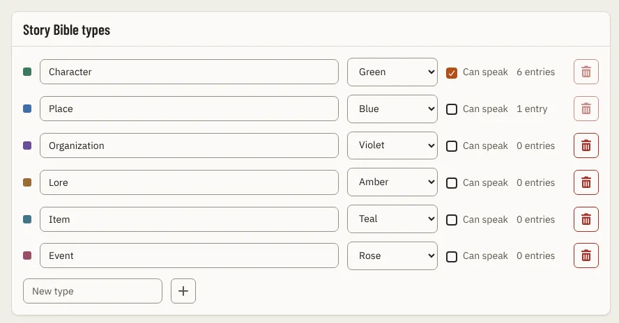

# StoryBibleTypesPanel

Storybook title: `Settings/Page/StoryBibleTypesPanel`. Source: `src/components/settings/page/StoryBibleTypesPanel.tsx`.

## Stories

- Default Types
- Last Type
- Reading
- Refused

## Used by

- `src/components/settings/page/SettingsPage.tsx`
