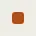

# Swatch

Storybook title: `Primitives/Swatch`. Source: `src/components/primitives/Swatch.tsx`.

## Stories

- Default
- Sized
- Hues

## Used by

- `src/components/script/page/rail/bible/BiblePanel.tsx`
- `src/components/script/page/rail/bible/kinds.ts`
- `src/components/script/page/rail/threads/NoteCard.tsx`
- `src/components/script/page/rail/threads/markSwatch.ts`
- `src/components/script/page/tools/select/KindMenu.tsx`
- `src/components/script/page/tools/select/MarkMenu.tsx`
- `src/components/script/page/tools/speaker/SpeakerPicker.tsx`
- `src/components/settings/page/StoryBibleTypesPanel.tsx`
- `src/components/storybible/Guide.tsx`
- `src/components/storybible/SpeakerColourField.tsx`
- `src/components/storybible/entryList.ts`
