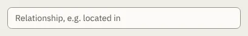

# TextField

Storybook title: `Primitives/TextField`. Source: `src/components/primitives/TextField.tsx`.

## Stories

- Empty
- Filled
- Disabled
- Monospace
- Colour Picker
- Read Only
- Typing Reports The Text
- Disabled Takes No Input

## Used by

- `src/components/delivery/profile/CommitBox.tsx`
- `src/components/layout/JumpMenu.tsx`
- `src/components/master/MasterToSpecPanel.tsx`
- `src/components/primitives/NumberInput.tsx`
- `src/components/primitives/SearchField.tsx`
- `src/components/schedule/ContractPanel.tsx`
- `src/components/schedule/MilestoneDialog.tsx`
- `src/components/schedule/MilestoneTable.tsx`
- `src/components/script/bookmarks/ui/BookmarkEditor.tsx`
- `src/components/script/page/rail/words/WordCard.tsx`
- `src/components/script/page/tools/find/FindBar.tsx`
- `src/components/script/page/tools/select/MarksDialog.tsx`
- `src/components/script/page/tools/speaker/SpeakerPicker.tsx`
- `src/components/series/SeriesTab.tsx`
- `src/components/settings/DeliveryProfileEditor.tsx`
- `src/components/settings/ScopedSetting.tsx`
- `src/components/settings/page/StoryBibleTypesPanel.tsx`
- `src/components/storybible/GuideDetail.tsx`
- `src/components/storybible/PropertiesSection.tsx`
- `src/components/storybible/VoiceReferencesSection.tsx`
- `src/components/storybible/source/NamePronunciation.tsx`
- `src/components/storybible/suggested/row/SuggestionRow.tsx`
