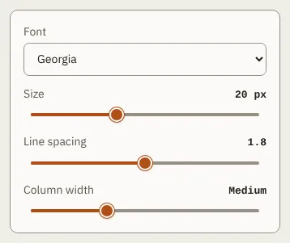

# TextSettings

Storybook title: `Script/TextSettings`. Source: `src/components/script/page/tools/text/TextSettings.tsx`.

## Stories

- Defaults
- Changed
- In Popover

## Used by

- `src/components/script/page/ScriptPage.tsx`
