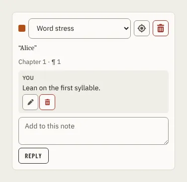

# ThreadsPanel

Storybook title: `Script/ThreadsPanel`. Source: `src/components/script/page/rail/threads/ThreadsPanel.tsx`.

## Stories

- Note
- Note Selected
- Open Query With Thread
- Resolved Queries
- All Queries
- Editing A Message
- Empty Notes
- Empty Queries
- Reopen Resolved

## Used by

- `src/components/script/page/rail/threads/ThreadsTab.tsx`
