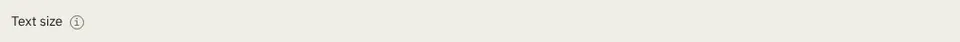

# Tooltip

Storybook title: `Primitives/Tooltip`. Source: `src/components/primitives/Tooltip.tsx`.

## Stories

- Info Icon
- Info Icon Shows Tooltip On Keyboard Focus
- Info Icon Keeps Open On Enter After Focus
- Info Icon Lets Tab Move On
- Info Icon Toggles On Press
- Info Icon Popup Takes Pointer Events
- On Button
- Shows Tooltip On Focus
- Escape Hides Tooltip
- Hides Tooltip On Blur
- On Disabled Button
- Disabled Button Explains Why On Focus
- Inline In Running Text

## Used by

- `.storybook/preview.tsx`
- `src/App.tsx`
- `src/components/booth/BoothView.tsx`
- `src/components/booth/BuiltinRecorder.tsx`
- `src/components/booth/ReaderRail.tsx`
- `src/components/booth/ReaderText.tsx`
- `src/components/booth/ReadingControlBar.tsx`
- `src/components/booth/record/SetupChip.tsx`
- `src/components/booth/resume/ResumeOffer.tsx`
- `src/components/editing/bar/SelectionActionButton.tsx`
- `src/components/editing/takes/split/SplitButton.tsx`
- `src/components/layout/AppShell.tsx`
- `src/components/layout/EngineChip.tsx`
- `src/components/manuscript/EntitySummary.tsx`
- `src/components/manuscript/ReaderCard.tsx`
- `src/components/master/MasterQcPage.tsx`
- `src/components/primitives/CapabilityGate.tsx`
- `src/components/primitives/ChapterStepper.tsx`
- `src/components/primitives/IconButton.tsx`
- `src/components/primitives/NavButton.tsx`
- `src/components/primitives/Pill.tsx`
- `src/components/primitives/SearchField.tsx`
- `src/components/primitives/Table.tsx`
- `src/components/primitives/TagInput.tsx`
- `src/components/primitives/TitleSubtitle.tsx`
- `src/components/production/ImportReview.tsx`
- `src/components/production/ManuscriptImport.tsx`
- `src/components/production/overview/CheckCountsCard.tsx`
- `src/components/production/overview/KpiRow.tsx`
- `src/components/production/pipeline/PageHeader.tsx`
- `src/components/production/pipeline/PipelineTable.tsx`
- `src/components/production/readiness/ReadinessChip.tsx`
- `src/components/proof/CompareRun.tsx`
- `src/components/proof/FindingDetail.tsx`
- `src/components/proof/FlagsPanel.tsx`
- `src/components/proof/PreviewPanel.tsx`
- `src/components/proof/ReaperControls.tsx`
- `src/components/proof/TakeComparisonView.tsx`
- `src/components/proof/TakeReviewReads.tsx`
- `src/components/proof/TakesPanel.tsx`
- `src/components/proof/TransportBar.tsx`
- `src/components/proof/frame/WaveformWindow.tsx`
- `src/components/proof/notes/NotesTable.tsx`
- `src/components/schedule/MilestoneTable.tsx`
- `src/components/script/bookmarks/ui/BookmarkRibbon.tsx`
- `src/components/script/page/tools/select/KindMenu.tsx`
- `src/components/script/page/tools/select/MarkMenu.tsx`
- `src/components/script/page/tools/select/SelectionTool.tsx`
- `src/components/script/page/tools/select/harness.tsx`
- `src/components/settings/ScopedSetting.tsx`
- `src/components/storybible/Guide.tsx`
- `src/components/storybible/GuideDetail.tsx`
- `src/components/storybible/PropertiesSection.tsx`
- `src/components/storybible/suggested/row/ConfidenceChip.tsx`
- `src/components/storybible/suggested/row/Quotes.tsx`
