# storybook-script

Every catalogued state, light beside dark, at every viewport. Real app = Playwright visual suite (mock mode); storybook = the atlas run.

storybook-script-biblepanel (6 states, 24 images)

| Page | State | Viewport | Light | Dark |
| - | - | - | - | - |
| storybook-script-biblepanel | character-entry | narrow |  |  |
| storybook-script-biblepanel | character-entry | wide |  |  |
| storybook-script-biblepanel | empty-chapter | narrow |  |  |
| storybook-script-biblepanel | empty-chapter | wide |  |  |
| storybook-script-biblepanel | links-go-where-they-say | narrow |  |  |
| storybook-script-biblepanel | links-go-where-they-say | wide |  |  |
| storybook-script-biblepanel | no-entry-selected | narrow |  |  |
| storybook-script-biblepanel | no-entry-selected | wide |  |  |
| storybook-script-biblepanel | place-entry | narrow |  |  |
| storybook-script-biblepanel | place-entry | wide |  |  |
| storybook-script-biblepanel | unknown-text | narrow | 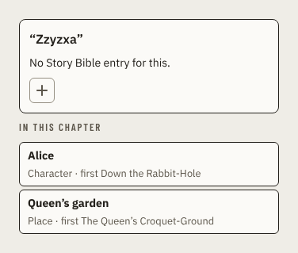 |  |
| storybook-script-biblepanel | unknown-text | wide |  |  |

storybook-script-bookmarkeditor (4 states, 16 images)

| Page | State | Viewport | Light | Dark |
| - | - | - | - | - |
| storybook-script-bookmarkeditor | empty | narrow |  | 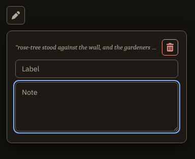 |
| storybook-script-bookmarkeditor | empty | wide |  |  |
| storybook-script-bookmarkeditor | near-the-limits | narrow |  | 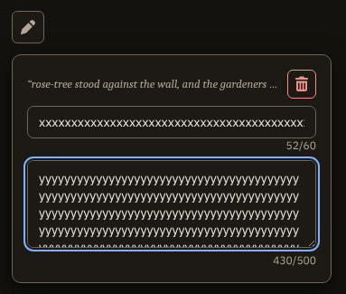 |
| storybook-script-bookmarkeditor | near-the-limits | wide |  | 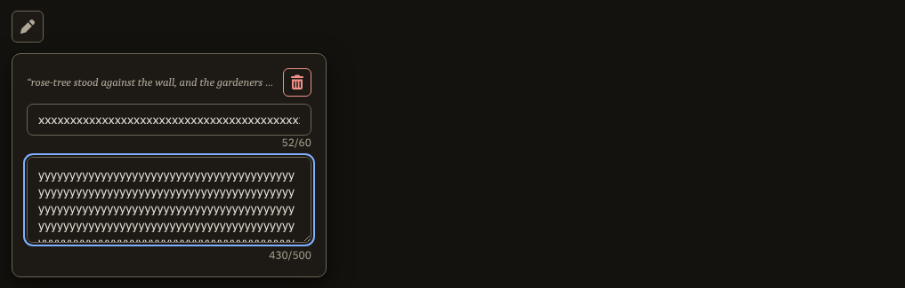 |
| storybook-script-bookmarkeditor | stale-line | narrow | 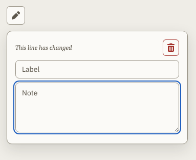 | 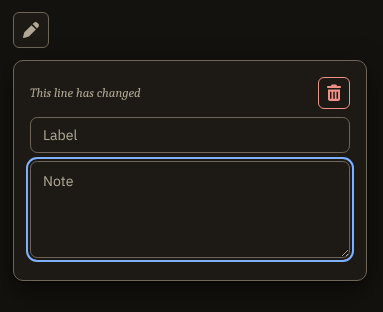 |
| storybook-script-bookmarkeditor | stale-line | wide |  |  |
| storybook-script-bookmarkeditor | with-text | narrow | 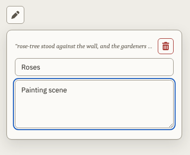 | 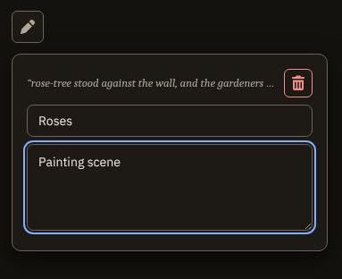 |
| storybook-script-bookmarkeditor | with-text | wide |  | 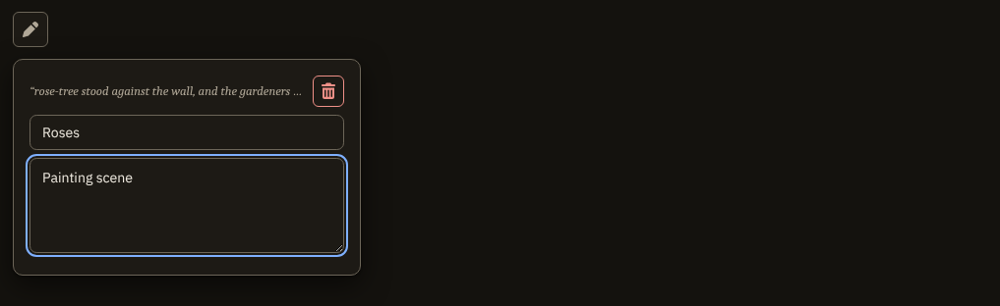 |

storybook-script-bookmarkribbon (5 states, 20 images)

| Page | State | Viewport | Light | Dark |
| - | - | - | - | - |
| storybook-script-bookmarkribbon | flashing-after-a-jump | narrow |  |  |
| storybook-script-bookmarkribbon | flashing-after-a-jump | wide |  |  |
| storybook-script-bookmarkribbon | opens-its-editor | narrow |  |  |
| storybook-script-bookmarkribbon | opens-its-editor | wide | 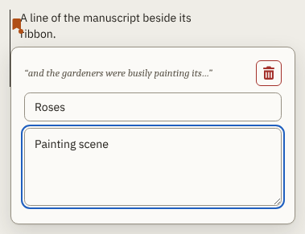 |  |
| storybook-script-bookmarkribbon | stale-draws-nothing | narrow |  |  |
| storybook-script-bookmarkribbon | stale-draws-nothing | wide | 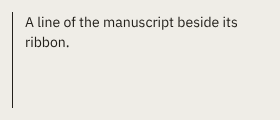 | 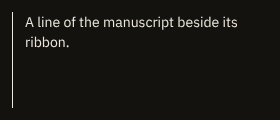 |
| storybook-script-bookmarkribbon | with-note | narrow |  |  |
| storybook-script-bookmarkribbon | with-note | wide |  |  |
| storybook-script-bookmarkribbon | without-note | narrow |  |  |
| storybook-script-bookmarkribbon | without-note | wide |  |  |

storybook-script-bookmarkstab (4 states, 16 images)

| Page | State | Viewport | Light | Dark |
| - | - | - | - | - |
| storybook-script-bookmarkstab | current-bookmark | narrow | 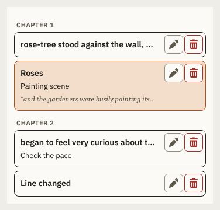 |  |
| storybook-script-bookmarkstab | current-bookmark | wide |  | 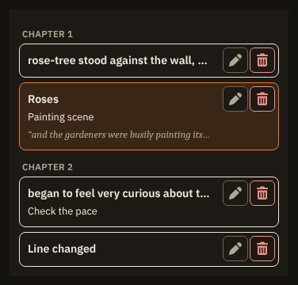 |
| storybook-script-bookmarkstab | empty | narrow |  |  |
| storybook-script-bookmarkstab | empty | wide |  |  |
| storybook-script-bookmarkstab | several-chapters | narrow |  |  |
| storybook-script-bookmarkstab | several-chapters | wide |  | 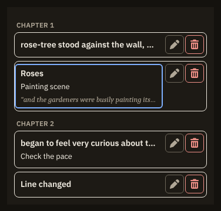 |
| storybook-script-bookmarkstab | stale-one | narrow |  |  |
| storybook-script-bookmarkstab | stale-one | wide |  | 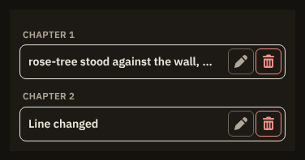 |

storybook-script-chaptercard (6 states, 24 images)

| Page | State | Viewport | Light | Dark |
| - | - | - | - | - |
| storybook-script-chaptercard | credits | narrow |  |  |
| storybook-script-chaptercard | credits | wide | 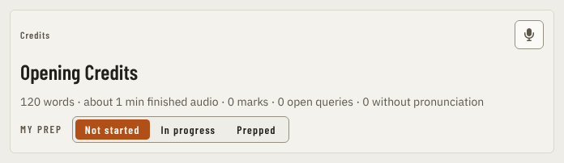 | 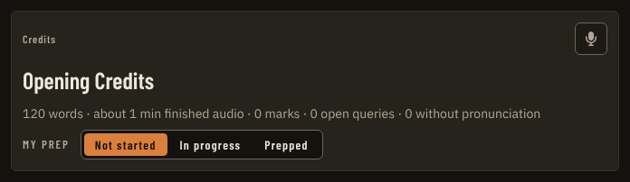 |
| storybook-script-chaptercard | in-progress | narrow |  |  |
| storybook-script-chaptercard | in-progress | wide |  |  |
| storybook-script-chaptercard | no-record-button | narrow |  |  |
| storybook-script-chaptercard | no-record-button | wide | 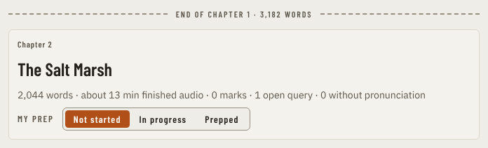 |  |
| storybook-script-chaptercard | not-started | narrow | 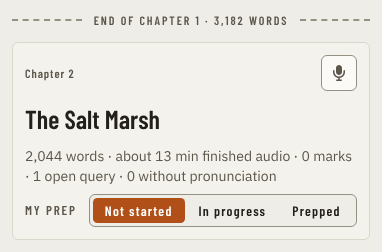 |  |
| storybook-script-chaptercard | not-started | wide | 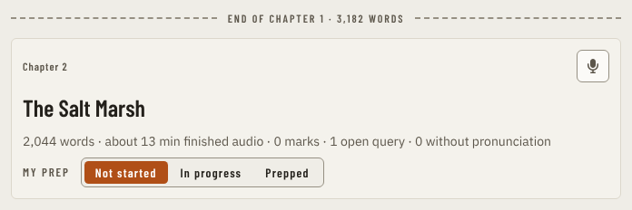 |  |
| storybook-script-chaptercard | prepped | narrow |  | 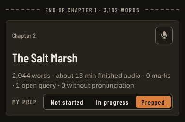 |
| storybook-script-chaptercard | prepped | wide |  |  |
| storybook-script-chaptercard | review-banner | narrow |  |  |
| storybook-script-chaptercard | review-banner | wide | 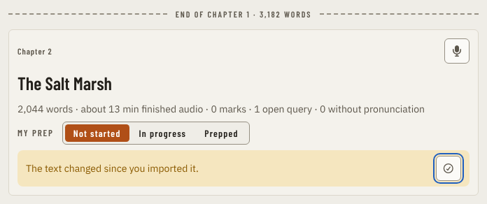 |  |

storybook-script-chapterlist (5 states, 20 images)

| Page | State | Viewport | Light | Dark |
| - | - | - | - | - |
| storybook-script-chapterlist | all-states | narrow |  | 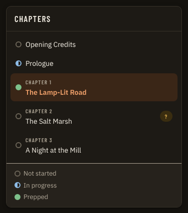 |
| storybook-script-chapterlist | all-states | wide |  |  |
| storybook-script-chapterlist | drawer | narrow |  |  |
| storybook-script-chapterlist | drawer | wide |  |  |
| storybook-script-chapterlist | forty-chapters | narrow |  |  |
| storybook-script-chapterlist | forty-chapters | wide |  |  |
| storybook-script-chapterlist | nothing-started | narrow | 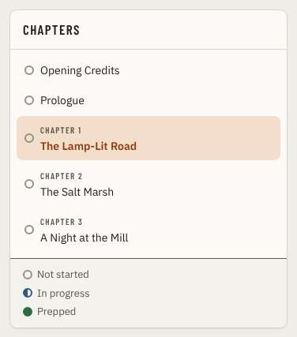 |  |
| storybook-script-chapterlist | nothing-started | wide |  |  |
| storybook-script-chapterlist | opening-credits | narrow |  | 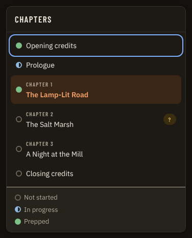 |
| storybook-script-chapterlist | opening-credits | wide | 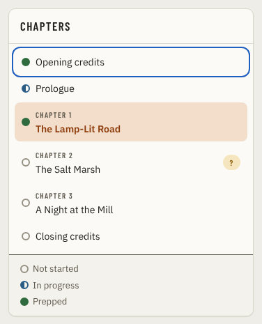 |  |

storybook-script-findbar (4 states, 16 images)

| Page | State | Viewport | Light | Dark |
| - | - | - | - | - |
| storybook-script-findbar | idle | narrow |  |  |
| storybook-script-findbar | idle | wide |  |  |
| storybook-script-findbar | list-open | narrow | 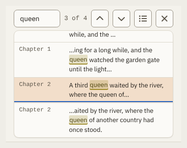 | 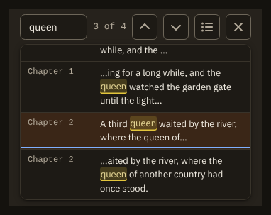 |
| storybook-script-findbar | list-open | wide | 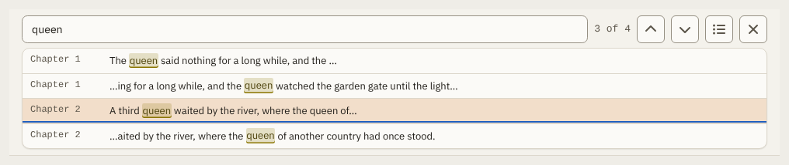 | 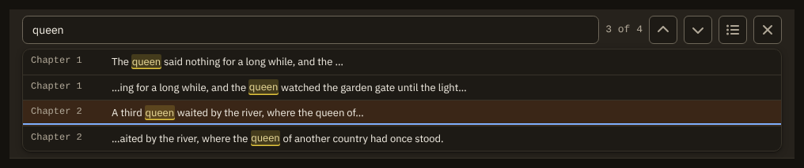 |
| storybook-script-findbar | matches | narrow |  |  |
| storybook-script-findbar | matches | wide |  |  |
| storybook-script-findbar | no-matches | narrow |  |  |
| storybook-script-findbar | no-matches | wide |  |  |

storybook-script-markcomposer (3 states, 12 images)

| Page | State | Viewport | Light | Dark |
| - | - | - | - | - |
| storybook-script-markcomposer | long-selection-is-shortened | narrow |  |  |
| storybook-script-markcomposer | long-selection-is-shortened | wide |  |  |
| storybook-script-markcomposer | note | narrow |  | 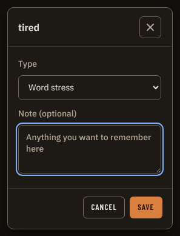 |
| storybook-script-markcomposer | note | wide |  | 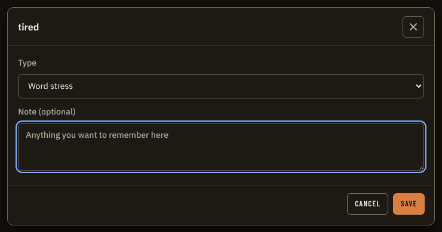 |
| storybook-script-markcomposer | query | narrow |  |  |
| storybook-script-markcomposer | query | wide |  | 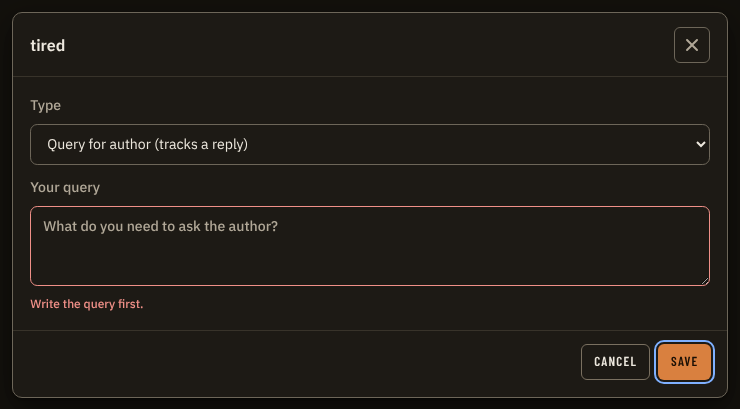 |

storybook-script-marksdialog (1 states, 4 images)

| Page | State | Viewport | Light | Dark |
| - | - | - | - | - |
| storybook-script-marksdialog | types | narrow |  | 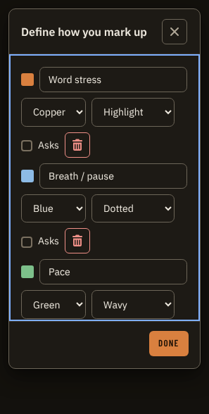 |
| storybook-script-marksdialog | types | wide |  | 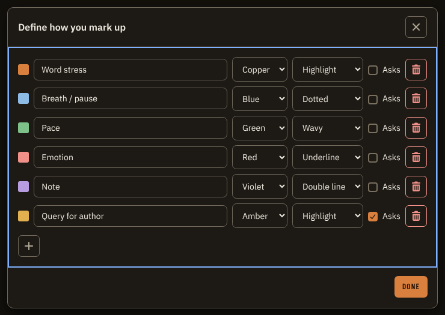 |

storybook-script-page (8 states, 32 images)

| Page | State | Viewport | Light | Dark |
| - | - | - | - | - |
| storybook-script-page | bookmarks-tab | narrow |  | 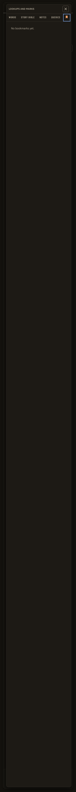 |
| storybook-script-page | bookmarks-tab | wide | 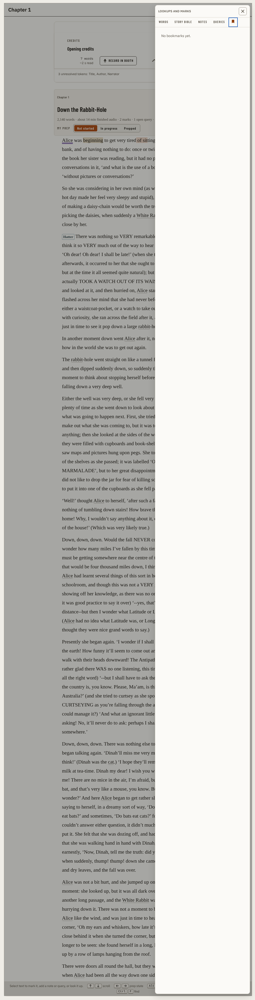 | 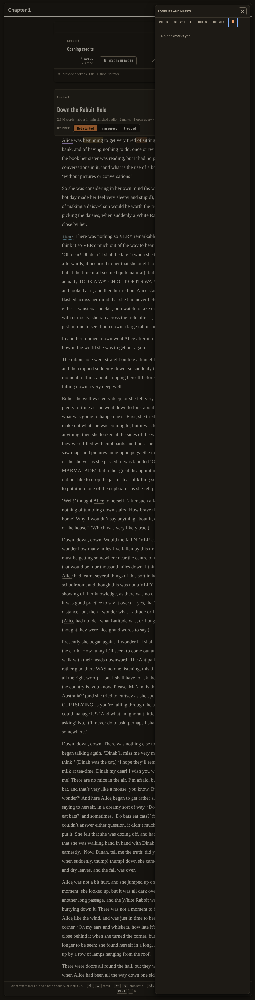 |
| storybook-script-page | chapter-drawer | narrow | 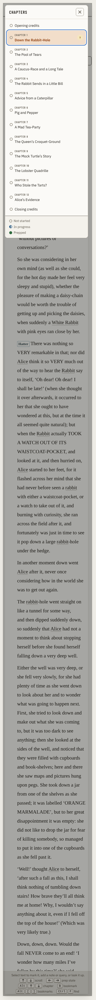 | 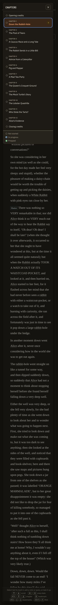 |
| storybook-script-page | chapter-drawer | wide | 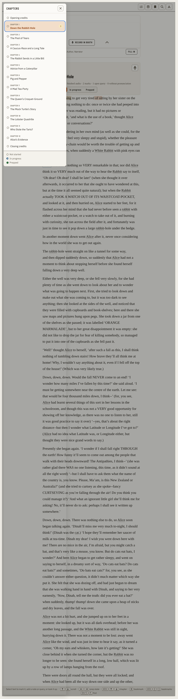 | 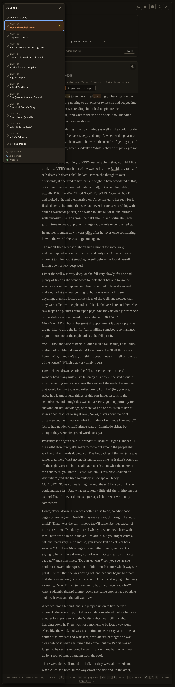 |
| storybook-script-page | no-manuscript | narrow |  |  |
| storybook-script-page | no-manuscript | wide |  | 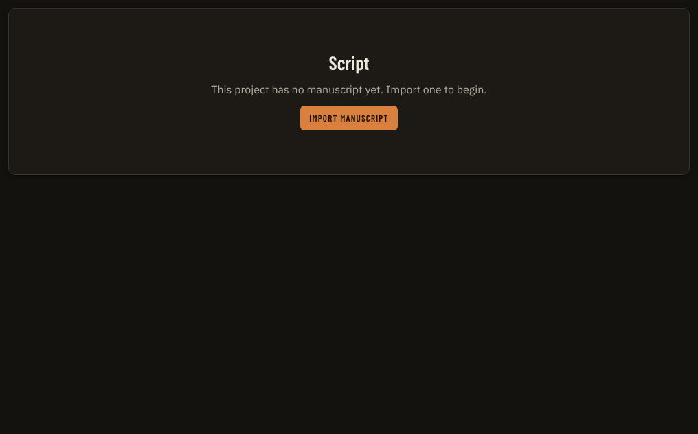 |
| storybook-script-page | notes-tab | narrow |  | 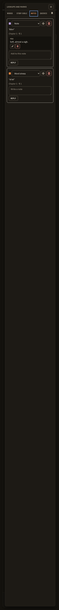 |
| storybook-script-page | notes-tab | wide | 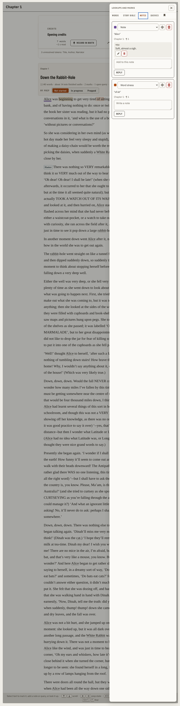 | 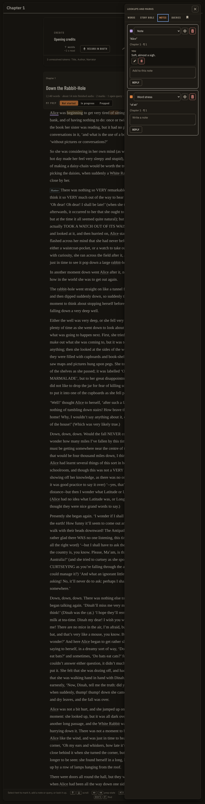 |
| storybook-script-page | queries-tab | narrow | 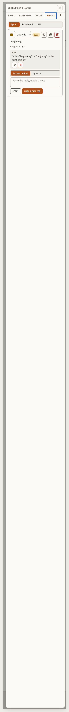 | 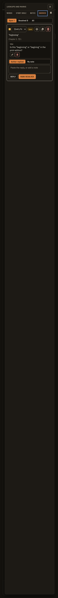 |
| storybook-script-page | queries-tab | wide | 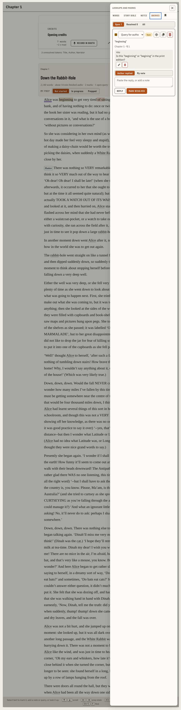 |  |
| storybook-script-page | rail-drawer | narrow |  |  |
| storybook-script-page | rail-drawer | wide |  |  |
| storybook-script-page | reader-with-marks | narrow |  |  |
| storybook-script-page | reader-with-marks | wide |  |  |
| storybook-script-page | story-bible-tab | narrow |  |  |
| storybook-script-page | story-bible-tab | wide |  |  |

storybook-script-reader (2 states, 8 images)

| Page | State | Viewport | Light | Dark |
| - | - | - | - | - |
| storybook-script-reader | marks-chips-and-a-find-match | narrow |  |  |
| storybook-script-reader | marks-chips-and-a-find-match | wide |  |  |
| storybook-script-reader | without-layers | narrow |  |  |
| storybook-script-reader | without-layers | wide |  |  |

storybook-script-reader-para (8 states, 32 images)

| Page | State | Viewport | Light | Dark |
| - | - | - | - | - |
| storybook-script-reader-para | all-layers | narrow |  |  |
| storybook-script-reader-para | all-layers | wide |  |  |
| storybook-script-reader-para | find-matches | narrow |  |  |
| storybook-script-reader-para | find-matches | wide |  |  |
| storybook-script-reader-para | flagged-words | narrow |  |  |
| storybook-script-reader-para | flagged-words | wide |  |  |
| storybook-script-reader-para | marks-of-each-style | narrow |  |  |
| storybook-script-reader-para | marks-of-each-style | wide |  |  |
| storybook-script-reader-para | name-mentions | narrow |  |  |
| storybook-script-reader-para | name-mentions | wide |  |  |
| storybook-script-reader-para | overlapping-marks | narrow |  |  |
| storybook-script-reader-para | overlapping-marks | wide |  |  |
| storybook-script-reader-para | plain-text | narrow |  |  |
| storybook-script-reader-para | plain-text | wide |  |  |
| storybook-script-reader-para | speaker-chips | narrow |  |  |
| storybook-script-reader-para | speaker-chips | wide |  |  |

storybook-script-selectiontool (5 states, 20 images)

| Page | State | Viewport | Light | Dark |
| - | - | - | - | - |
| storybook-script-selectiontool | disabled | narrow |  |  |
| storybook-script-selectiontool | disabled | wide |  |  |
| storybook-script-selectiontool | enabled | narrow |  |  |
| storybook-script-selectiontool | enabled | wide |  |  |
| storybook-script-selectiontool | mark-menu-open | narrow |  |  |
| storybook-script-selectiontool | mark-menu-open | wide |  |  |
| storybook-script-selectiontool | story-bible-menu-open | narrow |  |  |
| storybook-script-selectiontool | story-bible-menu-open | wide |  |  |
| storybook-script-selectiontool | without-record-here | narrow |  |  |
| storybook-script-selectiontool | without-record-here | wide |  |  |

storybook-script-speakerpicker (3 states, 12 images)

| Page | State | Viewport | Light | Dark |
| - | - | - | - | - |
| storybook-script-speakerpicker | empty | narrow |  |  |
| storybook-script-speakerpicker | empty | wide |  |  |
| storybook-script-speakerpicker | searching | narrow |  |  |
| storybook-script-speakerpicker | searching | wide |  |  |
| storybook-script-speakerpicker | suggested | narrow |  |  |
| storybook-script-speakerpicker | suggested | wide |  |  |

storybook-script-textsettings (3 states, 12 images)

| Page | State | Viewport | Light | Dark |
| - | - | - | - | - |
| storybook-script-textsettings | changed | narrow |  |  |
| storybook-script-textsettings | changed | wide |  |  |
| storybook-script-textsettings | defaults | narrow |  |  |
| storybook-script-textsettings | defaults | wide |  |  |
| storybook-script-textsettings | in-popover | narrow |  |  |
| storybook-script-textsettings | in-popover | wide |  |  |

storybook-script-threadspanel (9 states, 36 images)

| Page | State | Viewport | Light | Dark |
| - | - | - | - | - |
| storybook-script-threadspanel | all-queries | narrow |  |  |
| storybook-script-threadspanel | all-queries | wide |  |  |
| storybook-script-threadspanel | editing-a-message | narrow |  |  |
| storybook-script-threadspanel | editing-a-message | wide |  |  |
| storybook-script-threadspanel | empty-notes | narrow |  |  |
| storybook-script-threadspanel | empty-notes | wide |  |  |
| storybook-script-threadspanel | empty-queries | narrow |  |  |
| storybook-script-threadspanel | empty-queries | wide |  |  |
| storybook-script-threadspanel | note | narrow |  |  |
| storybook-script-threadspanel | note | wide |  |  |
| storybook-script-threadspanel | note-selected | narrow |  |  |
| storybook-script-threadspanel | note-selected | wide |  |  |
| storybook-script-threadspanel | open-query-with-thread | narrow |  |  |
| storybook-script-threadspanel | open-query-with-thread | wide |  |  |
| storybook-script-threadspanel | reopen-resolved | narrow |  |  |
| storybook-script-threadspanel | reopen-resolved | wide |  |  |
| storybook-script-threadspanel | resolved-queries | narrow |  |  |
| storybook-script-threadspanel | resolved-queries | wide |  |  |

storybook-script-wordstab (10 states, 40 images)

| Page | State | Viewport | Light | Dark |
| - | - | - | - | - |
| storybook-script-wordstab | card-not-flagged | narrow |  |  |
| storybook-script-wordstab | card-not-flagged | wide |  |  |
| storybook-script-wordstab | card-not-set | narrow |  |  |
| storybook-script-wordstab | card-not-set | wide |  |  |
| storybook-script-wordstab | card-set | narrow |  |  |
| storybook-script-wordstab | card-set | wide |  |  |
| storybook-script-wordstab | definition-local | narrow |  |  |
| storybook-script-wordstab | definition-local | wide |  |  |
| storybook-script-wordstab | definition-local-not-installed | narrow |  |  |
| storybook-script-wordstab | definition-local-not-installed | wide |  |  |
| storybook-script-wordstab | definition-online | narrow |  |  |
| storybook-script-wordstab | definition-online | wide |  |  |
| storybook-script-wordstab | definition-online-unreachable | narrow |  |  |
| storybook-script-wordstab | definition-online-unreachable | wide |  |  |
| storybook-script-wordstab | definition-web-page | narrow |  |  |
| storybook-script-wordstab | definition-web-page | wide |  |  |
| storybook-script-wordstab | no-words-marked | narrow |  |  |
| storybook-script-wordstab | no-words-marked | wide |  |  |
| storybook-script-wordstab | several-words | narrow |  |  |
| storybook-script-wordstab | several-words | wide |  |  |

